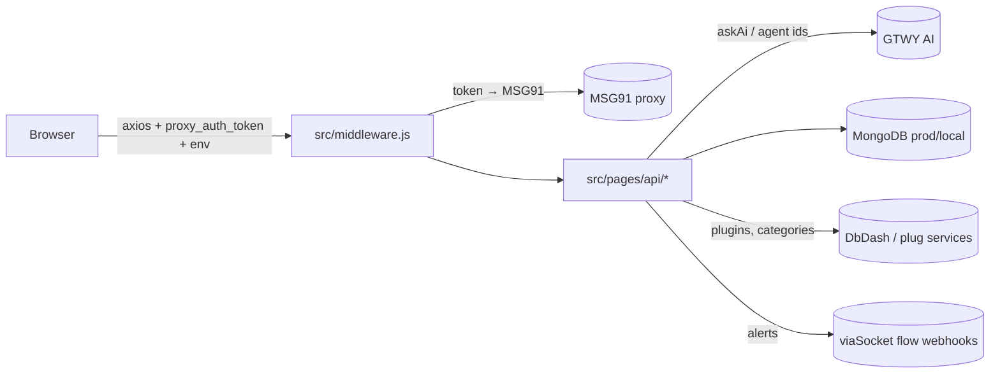

# Architecture

viaSocket Automation Ideas is one Next.js 14 **pages-router** app served under the `/automation-ideas` base path on `https://viasocket.com`. It holds the website, the product UI, and its own API routes. There is no separate backend, CLI, or SDK in this repo.

Reviewed against commit `9e85766` on branch `automation-ideas`. This describes what the code does, which is not necessarily product intent.

## Two content systems

| | Automation use cases | AI blogs |
| --- | --- | --- |
| Source of truth | MongoDB `Usecase` collection (`models/UsecaseModel.js`) | MongoDB `Blog` collection (`models/BlogModel.js`) |
| Created by | Signed-in users via home search / `POST /api/usecases` (AI agents `USECASE_CREATE` / `USECASE_UPDATE`) | Signed-in users through AI chat (`ask-ai`), batch improve routes |
| Primary pages | `src/pages/usecase/[...usecaseId]/` (SSR) | `src/pages/blog/[...blogId]/` (SSR) |
| Live after | Database write | Database write |
| Compare / file CMS | **n/a** — no `content/compare/` on this branch | **n/a** |

Static marketing: `src/pages/razorpay/` reads fixed data from `src/data/razorpayAutomationData.js` (not Mongo).

## Source map

| Concern | Location |
| --- | --- |
| Pages (routes) | `src/pages/`. App-router leftovers: `src/page.js`, `src/layout.js`, `src/page.module.css`. |
| Components | `src/components/<Name>/<Name>.js` + `*.module.scss`. |
| API routes | `src/pages/api/`. See [API routes](#api-routes). |
| Server services | `src/services/` — `blogServices.js`, `usecaseServices.js`, `integrationServices.js`, `proxyServices.js`, `aiServices.js` (if present). |
| Client API wrappers | `src/utils/apis/*.js`, `src/utils/apiHelper.js`. `src/utils/interceptor.js` adds `proxy_auth_token` and `env` to axios. |
| AI helper | `askAi()` in `src/utils/utils.js` → GTWY AI (`api.gtwy.ai`). |
| AI response schemas | `src/utils/schema.js` (Joi), via `ValidateAiResponse()` in `src/utils/utils.js`. |
| A/B recording | `src/utils/experiments.js` (`mwVariant`, `mwSend`); unused by pages today. |
| Mongo connection | `lib/mongoDb.js` at repo root (`@/` maps to `src/` only). |
| Auth | `src/middleware.js`, `src/auth.js`, `src/pages/auth/index.js`, `src/context/UserContext.js`, `src/utils/storageHelper.js`. |
| Next config | `next.config.mjs` — `basePath: '/automation-ideas'`. |

## Data model (MongoDB, mongoose)

- **Usecase** (`models/UsecaseModel.js`): `apps[]` (app, app_slug, iconUrl, domain), SEO fields (`h1`, `meta_title`, …), `phases[]` (nested use cases), `related_apps`, `faqs`, `comments` object, `createdBy`, `contributors`, `toUpdate`, timestamps. Index on `apps.app_slug`.
- **Blog** (`models/BlogModel.js`): `id`, `title`, `slugName`, `blog` sections object, `tags`, `apps` (dots in keys stored as `~`), `meta`, `comments`, `toUpdate`, `toImprove`, `countryCode`, `createdBy[]`, etc. Text index on title/tags/meta fields.
- **Author** (`models/AuthorModel.js`): writer personas for improve routes.
- **Tags** (`models/tagsModel.js`): tags, categories, parameters arrays.
- Users are not stored here; they come from MSG91 proxy (`proxyServices.js`).

**Database selection:** `connectToDatabase(environment)` uses `MONGODB_URI` when `environment === 'prod'`, else `MONGODB_URI_LOCAL`. API routes read `env` from the request header; SSR pages use `getCurrentEnvironment()` from `NEXT_PUBLIC_NEXT_API_ENVIRONMENT`.

## Main flows

- **Home → use case:** search picks apps; client calls `POST /api/usecases` with `apps` and optional message. `suggestAppUsecases` in `usecaseServices.js` calls AI, deduplicates by app set, enriches icons, saves `Usecase`. User is redirected to `/usecase/<app-slug>-automation-ideas` (see `src/pages/index.js`).
- **Home → blog:** legacy path still uses `NEXT_PUBLIC_HOME_PAGE_BRIDGE` and `createBlog()` in `ask-ai.js` (same pattern as Discovery main).
- **Usecase page:** `getServerSideProps` resolves slug variants (full heading slug vs app slug). Comments via `/api/usecases/<id>/comments`. `BuildFlowButton` links to `https://viasocket.com/signup` with a prompt query param (TODO in code for a dedicated flow URL).
- **Batch jobs (no UI caller in repo):** `update-usecases`, `update-blogs`, `improve-blogs`, `sync-apps`, `tags`, `mongo-to-dbdash`, `udpate-blog-from-db-dash`. Several send an early 200 then continue async work.

## API routes

Paths are under `/automation-ideas/api`. **Gate** = `src/middleware.js` requires a valid `proxy_auth_token` for listed methods (`pathname.startsWith`).

| Route | Methods | Gate | Role |
| --- | --- | --- | --- |
| `usecases` | GET, POST | POST | List/search; create use case via AI |
| `usecases/recent` | GET | none | Recently published use cases |
| `usecases/[usecaseId]` | GET | none | Fetch one |
| `usecases/[usecaseId]/comments` | GET, POST | POST (via parent `/api/usecases` prefix — POST only on collection) | Comments |
| `blog`, `blog/[blogId]`, comments, `update-blog` | various | POST on collection; see middleware | Blogs (Discovery-era surface) |
| `ask-ai` | POST | POST | Chat bridges; blogs, comments, bio |
| `gethistory` | GET | GET | AI thread history |
| `public-blogs`, `related-blogs/[blogId]` | GET | none | Read-only |
| `integrations`, `plugins`, `suggestions`, `compare-blogs` | POST | none | Plugins, titles, AI compare |
| `update-usecases`, `update-blogs`, `improve-blogs`, `improve/[id]`, `sync-apps`, `tags`, `mongo-to-dbdash`, `udpate-blog-from-db-dash` | various | none | Batch / maintenance |
| `users` | POST | none | Mints JWT (see security doc) |
| `serverhealth` | any | none | Always 200 |
| `ai` | — | none | Stub |

**Note:** Middleware lists `PATCH` on `/api/usecases`, but `src/pages/api/usecases.js` has no `PATCH` handler (only GET/POST). Treat as dead config until implemented.

## External dependencies

| Service | Used for |
| --- | --- |
| MSG91 proxy | Login, user profile, AI thread history |
| GTWY AI | Generation (bridge ids in env) |
| MongoDB | Blogs, use cases, tags, authors |
| DbDash / plug APIs | Plugin metadata, categories (`integrationServices.js`, `tags.js`) |
| viaSocket flows | Alerts / sync webhooks (`sendMessageTochannel`) |
| Middleware events URL | A/B variant and event recording when `NEXT_PUBLIC_MW_*` set |
| GTM / GA | Prod only in `_app.js` |

## UI stack

MUI 6 + Emotion, Bootstrap 5 (JS loaded in `_app.js`), Sass modules, `react-icons`, `react-toastify`. Global styles: `src/globals.scss`. No documented design system or accessibility standard in repo.