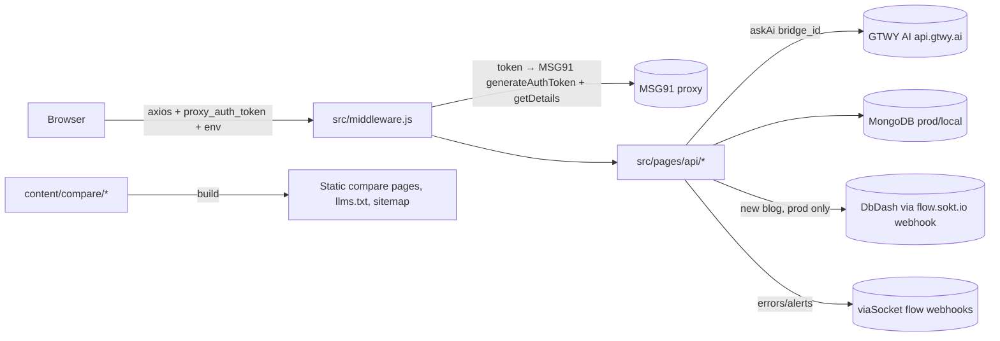

# Architecture

viaSocket Discovery is one Next.js 14 **pages-router** app served under the `/discovery` base path on `https://viasocket.com`. It holds the website, the product UI, and its own API routes. There is no separate backend, CLI, or SDK in this repo.

Reviewed against commit `7cab049`. Everything here comes from the code. It describes what the code does, which is not necessarily what the product intends.

## Two content systems

| | AI blogs ("Discovery" articles) | Compare pages |
| --- | --- | --- |
| Source of truth | MongoDB `Blog` collection (`models/BlogModel.js`) | Folders in `content/compare/<slug>/` |
| Created by | Signed-in users through the AI chat, then improved by batch AI routes | Committing a folder ([README](../README.md#compare-pages)) |
| Rendering | `getServerSideProps` on every request (`src/pages/blog/[...blogId]/index.js`) | `getStaticProps` at build time (`src/pages/compare/`) |
| Live after | The database write | The next build and deploy |
| In `sitemap.xml` / `llms.txt` | No | Yes |

## Source map

| Concern | Location |
| --- | --- |
| Pages (routes) | `src/pages/` (pages router). `src/page.js`, `src/layout.js`, and `src/page.module.css` are app-router leftovers. They are not routes, and `src/layout.js` imports a missing `./globals.css`. |
| Components | `src/components/<Name>/<Name>.js` + `*.module.scss`. Compare UI is in `src/components/Compare/`. |
| API routes | `src/pages/api/`. See the [API route table](#api-routes). |
| Server services | `src/services/` (Mongo via `blogServices.js`, `tagsServices.js`, `authorServices.js`; MSG91 proxy users in `proxyServices.js`; plugins in `integrationServices.js`; title suggestions in `aiServices.js`) |
| Client API wrappers | `src/utils/apis/*.js`, `src/utils/apiHelper.js`. `src/utils/interceptor.js` adds the `proxy_auth_token` and `env` headers to every axios call. |
| AI call helper | `askAi()` in `src/utils/utils.js` posts to `https://api.gtwy.ai/api/v2/model/chat/completion` with a `bridge_id` and a 3-minute timeout. |
| AI response schemas | `src/utils/schema.js` (Joi), checked by `ValidateAiResponse()` in `src/utils/utils.js` |
| Compare content engine | `src/lib/compareContent.js` (reads folders, heading ids, FAQ extraction, JSON-LD, `llms.txt`, sitemap) |
| Public URLs | `src/lib/site.js` `discoveryUrl()` → `https://viasocket.com/discovery/...` |
| Mongo connection | `lib/mongoDb.js` at the repo root, not `src/lib`. The `@/` alias maps to `src/` (`jsconfig.json`). |
| Auth | `src/middleware.js`, `src/auth.js`, `src/pages/auth/index.js`, `src/context/UserContext.js`, `src/utils/storageHelper.js` |
| Next config | `next.config.js` (`basePath: '/discovery'`) is the one that loads: the build's `routes-manifest.json` has `basePath` `/discovery`. `next.config.mjs` is an unused empty config. |

## Data model (MongoDB, mongoose)

- `Blog` (`models/BlogModel.js`) has `id` (unique string), `title`, `slugName`, `blog` (sections), `tags`, `apps` (object keyed by app name; dots in keys are stored as `~`), `appNames`, `meta` (category, SEO keywords, audience…), `comments` (an object keyed by comment id, status `pending`…), `toUpdate`, `toImprove`, `lastImproved`, `countryCode` (required), `createdBy` (array of user ids), and timestamps. It has a text index on title, tags, category, SEO keywords, audience, and app names.
- `Author` (`models/AuthorModel.js`) has `name`, `countryCode`, and `profession` (default `writer`). Improve routes use it to pick a writer persona. It always uses the `prod` connection.
- `Tags` (`models/tagsModel.js`) holds arrays of `tags`, `categories`, and `parameters`.
- Users are not stored here. They live in MSG91 proxy (`routes.msg91.com/api/<PROXY_USER_REFERENCE_ID>/getDetails`).

**Database selection:** `connectToDatabase(environment)` uses `MONGODB_URI` when `environment === 'prod'` and `MONGODB_URI_LOCAL` otherwise. API routes take `environment` from the request's `env` header, which the browser sets from `NEXT_PUBLIC_NEXT_API_ENVIRONMENT`. Server-rendered pages call `getCurrentEnvironment()` directly.

## Main flows

- **Ask / create blog:** the home page search calls `POST /api/ask-ai` with `bridgeId = NEXT_PUBLIC_HOME_PAGE_BRIDGE`. If the AI answers `shouldCreate`, `createBlog()` in `src/pages/api/ask-ai.js` runs the blueprint bridge (`BLUE_PRINT_BRIDGE`) and then writes the blog. `POST /api/blog` also calls `createBlog()`. New prod blogs are posted to DbDash (`SendNewBlogTODbDash`).
- **Edit blog via chat:** `src/pages/edit/[chatId]` calls `ask-ai` with `NEXT_PUBLIC_UPDATE_PAGE_BRIDGE`. It either updates the blog or creates a new one.
- **Comments:** `POST /api/blog/<id>/comments` stores a `pending` comment. `POST /api/update-blogs` merges comments into blogs with AI (`updateBlogUsingComments` in `src/pages/api/blog/[blogId]/update-blog.js`).
- **Batch maintenance (no UI caller found):** `improve-blogs`, `improve/[id]`, `update-blogs`, `sync-apps`, `tags`, `mongo-to-dbdash`, and `udpate-blog-from-db-dash` (sic). Results go to a viaSocket webhook through `sendMessageTochannel`. How these are scheduled is not in this repo.
- **Compare pages:** see [README → Compare pages](../README.md#compare-pages). `getComparePage()` turns `h2`s into the "On this page" index, `details/summary` into FAQ JSON-LD, and adjacent tables into a side-by-side row.

## API routes

All paths are under `/discovery/api`. "Gate" means `src/middleware.js` requires a valid `proxy_auth_token` for those methods. It matches with `pathname.startsWith`, so `/api/blog` also covers `/api/blog/<id>/...`.

| Route | Methods | Gate | Does |
| --- | --- | --- | --- |
| `blog` | GET, POST | POST | List/search blogs; create a blog with AI |
| `blog/[blogId]` | GET, PATCH | none (PATCH not in the map) | Read; update (reads `x-profile`) |
| `blog/[blogId]/comments` | GET, POST | POST | List; add a pending comment |
| `blog/[blogId]/comments/[commentId]` | GET, PUT, DELETE | PUT, DELETE | Read, update, delete a comment |
| `blog/[blogId]/update-blog` | GET | none (GET is not gated) | Merges comments into the blog with AI. This GET writes to the database. |
| `ask-ai` | POST | POST | Chat with an AI bridge; may create or update blogs, comments, and user bio |
| `gethistory` | GET | GET | AI thread history (msg91 proxy) |
| `public-blogs`, `related-blogs/[blogId]` | GET | none | Read-only lists |
| `integrations` | POST | none | Plugin details from DbDash and the recommendation service |
| `suggestions` | POST | none | AI title suggestions |
| `compare-blogs` | POST | none | AI comparison (`BRIDGE_ID_FOR_COMPARE`) |
| `tags` | POST | none | AI merge of tags, parameters, and categories |
| `improve-blogs`, `improve/[id]`, `update-blogs`, `sync-apps`, `mongo-to-dbdash`, `udpate-blog-from-db-dash` | POST/GET/PATCH | none | Batch writes. See [security](security-and-operations.md#trust-boundaries). |
| `users` | POST | none | Signs a 48h JWT with `TOKEN_SECRET_KEY` for the posted email and id. No caller or verifier in this repo. |
| `serverhealth` | any | none | Always `200 {status:"ok"}`. It does not check dependencies. |
| `ai` | — | none | Stub. It never sends a response. |

## External dependencies

| Service | Used for | Where |
| --- | --- | --- |
| MSG91 proxy (`routes.msg91.com`) | Login token → JWT, user details, bio update, AI thread history | `src/auth.js`, `src/services/proxyServices.js`, `src/pages/api/gethistory.js`, `compare-blogs.js` |
| GTWY AI (`api.gtwy.ai`) | All AI generation, selected by bridge id env vars or hard-coded ids | `askAi()` in `src/utils/utils.js` |
| MongoDB | Blogs, tags, authors | `lib/mongoDb.js` |
| DbDash (`table-api.viasocket.com`) | Categories and plugin tables | `src/pages/api/tags.js`, `src/services/integrationServices.js` |
| viaSocket flows (`flow.sokt.io`) | Alerts, new-blog sync, app updates | `src/utils/utils.js`, `src/services/integrationServices.js` |
| Plug recommendation service (Cloud Run) | Recommended integrations | `src/services/integrationServices.js` |
| Google Tag Manager / GA | Analytics, prod only | `src/pages/_app.js` |

## UI stack

MUI 6 + Emotion, Bootstrap 5 (its CSS and JS bundle are loaded in `_app.js`), Sass modules, `react-icons`, and `react-toastify`. Global styles are in `src/globals.scss`. There is no documented design system, token set, or accessibility standard. See [maintenance](maintenance.md#coverage-map).
